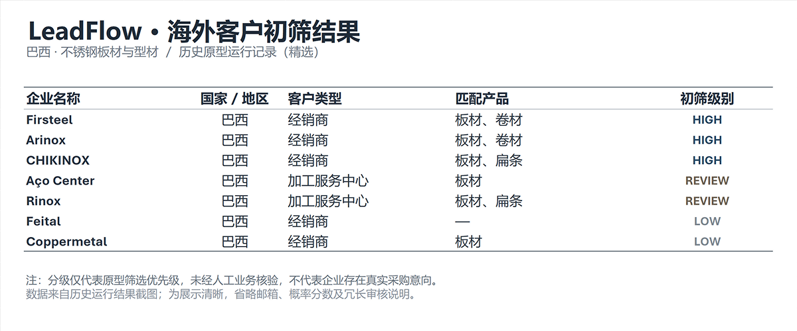

[简体中文](README.md) | English

# LeadFlow

**Discover potential B2B customers from public overseas sources, with evidence you can review.**

LeadFlow is a Python prototype for overseas company discovery and sales intelligence. Given a target country and product, it searches company websites, extracts business evidence, assesses product relevance and potential customer roles, and produces structured candidates with historical deduplication and review priorities.

The challenge in overseas prospecting is more than finding websites: it is **identifying companies worth researching and making those judgments traceable and reusable.**

## Historical run results

An early live run targeting the Brazilian stainless steel flat products and profiles market produced:

| Search results | Unique candidate domains | Candidates with usable official-site evidence | HIGH, pending review |
|---:|---:|---:|---:|
| 114 | 47 | 41 | 20 |

The remaining 21 candidates with evidence were classified as 10 REVIEW and 11 LOW. Public email addresses were observed in 12 records.

These are historical prototype results, not an independent rerun of the current release. HIGH indicates a higher priority for human review; **it does not establish purchasing intent or a sales-qualified customer**.

Subsequent development completed a small live end-to-end validation for the US stainless steel market and refined market switching, company-name identification and contact handling.

[View the public sample](example_output/README.md) · [View verification records](docs/verification.md)

### Output preview



*A sanitized excerpt from a historical live run. Grades indicate model screening priorities, not confirmed purchasing intent.*

## How LeadFlow works

The input is **Country + Product**, for example `Brazil + Stainless Steel Flat/Profiles`.

| Stage | Processing |
|---|---|
| Discovery | Build queries around the market, material, product forms and customer roles |
| Evidence collection | Filter for company websites and extract product, business and market information |
| Assessment | Use rules and TypeSafe Jev to assess relevance and commercial roles |
| Record management | Validate company-name evidence, identify duplicates and protect historical business state |
| Output | Export prioritized candidates, source evidence, contact details and items requiring human review |

Main outputs include:

- `leads.csv`: a company list for business users to browse and filter
- `leads.json`: fuller company records and supporting evidence
- `summary.json`: results, API usage, errors and execution status
- Review files: name conflicts, possible duplicates and unresolved contact attribution

### Three key design choices

**1. Start with evidence instead of asking AI to generate a customer list.**

A search result is not a verified match. The system prioritizes official websites and saves source URLs and evidence excerpts. Unsupported information stays unknown; it does not guess purchasing volumes, import capability or contact email addresses.

**2. Use deterministic rules for explicit checks and AI for semantic judgments.**

Python rules handle domain normalization, page filtering, email attribution and record updates. TypeSafe Jev assesses product relevance and likely commercial roles. HIGH / REVIEW / LOW organize review priorities rather than replace sales judgment.

**3. Make discovery a repeatable workflow.**

SQLite preserves company history and avoids duplicate accounts. Name changes, possible cross-domain duplicates and ambiguous contact details have dedicated review mechanisms. API request budgets and partial-failure reporting keep technical execution separate from business-goal achievement.

## Quick start

Python 3.10+ is required. The runtime uses only the Python standard library and external APIs; no third-party Python packages need to be installed.

Clone the repository and run the offline tests:

```bash
git clone https://github.com/Wuwalaya/leadflow.git
cd leadflow

python3 -m unittest -v
```

Inspect a search plan for a target market:

```bash
python3 leadflow.py plan \
  --country USA \
  --product "Stainless Steel Flat/Profiles"
```

You can also validate processing and deduplication without APIs using the bundled **synthetic test data**:

```bash
CHECK_DIR=$(mktemp -d)

python3 leadflow.py reference \
  --db "$CHECK_DIR/demo.sqlite" \
  --out "$CHECK_DIR/run1"

python3 leadflow.py reference \
  --db "$CHECK_DIR/demo.sqlite" \
  --out "$CHECK_DIR/run2"
```

The first run should create two synthetic accounts; the second should identify and update those same accounts, keeping the total unchanged. The fixture contains no real customers or real email addresses and does not demonstrate live discovery capability.

### Live use

Live discovery requires `TAVILY_API_KEY` and `TYPESAFE_API_KEY`; see [.env.example](.env.example).

Start with small smoke tests, then run `discover` within an explicit request budget. External requests may incur charges; a request-count limit is not a monetary limit.

See [architecture and runtime instructions](docs/architecture.md) for commands and parameters.

## Technical implementation

| Component | Technology |
|---|---|
| Workflow and data processing | Python 3.10+ |
| Web search and extraction | Tavily Search / Extract |
| Semantic assessment | TypeSafe Jev · System One API |
| Data storage | SQLite |
| Testing and evaluation | unittest, offline fixtures and human-review templates |

The project was independently designed and implemented by its developer, with Codex assisting coding, testing and iteration. Codex does not participate in the runtime discovery workflow.

## Current verification status

| Scenario | Status |
|---|---|
| Brazilian stainless steel flat products / profiles | Historical live runs and offline regression coverage |
| US stainless steel flat products / profiles | Small live end-to-end validation completed; still an experimental market configuration |
| US carbon steel sheet / plate | Configuration and processing validated offline; live effectiveness not evaluated |
| Contact enrichment | Single-page Contact Extract validated; improved email coverage has not been demonstrated |
| Business quality | Independent human labels and sales feedback are insufficient to report reliable accuracy or actual ROI |

Supported target combinations are defined in the project configuration. Official-site evidence may be incomplete or stale, a domain may not represent an independent legal entity, and a public email address does not establish deliverability or permission to contact.

LeadFlow remains a **prototype for assisted research and human review**. It has no ERP / CRM integration, does not automatically send marketing emails, and has not been deployed in enterprise production. It is an independent personal project, not an official system for any company.

## Further reading

[Architecture](docs/architecture.md) · [Data contracts](docs/data-contracts.md) · [Verification records](docs/verification.md) · [Changelog](CHANGELOG.md) · [Release checklist](docs/release-checklist.md)

[简体中文文档](README.md)
